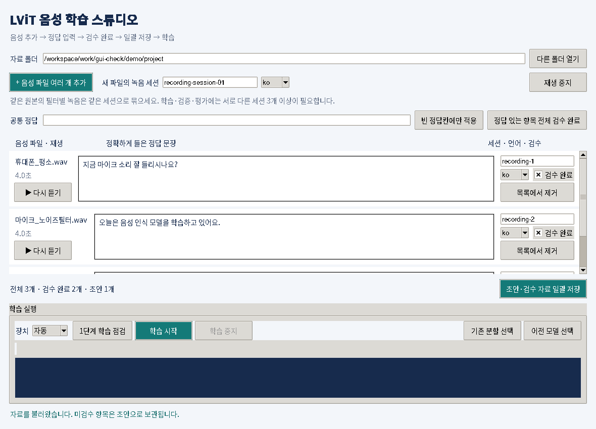

# LViT_speech_AI

**Whisper small을 추가 학습하는 독립 음성 인식 개발 도구**입니다. PC 앱에서 여러 녹음 파일 옆에 정답을 입력하고 일괄 저장한 뒤, LoRA 학습을 실행할 수 있습니다. 원본 모델과의 평가 및 int8 faster-whisper 모델 내보내기는 명령행 도구로 제공합니다. LViT 앱을 실행하지 않고 사용할 수 있습니다.

학습된 전용 가중치와 실제 인식 정확도 향상 결과는 아직 없습니다. LViT 앱의 사용자 모델 선택 기능은 후속 작업입니다.



위 화면은 Linux 테스트 환경에서 합성 음성과 예시 정답으로 실행했습니다. Windows에서는 시스템 글꼴과 창 모양이 다를 수 있습니다.

## PC 앱으로 파일과 정답 등록하기

Windows에 [Python 3.11 64비트](https://www.python.org/ftp/python/3.11.9/python-3.11.9-amd64.exe)(Tcl/Tk 포함)을 설치한 뒤 진행합니다. 설치 첫 화면에서 **Add python.exe to PATH**를 체크하세요.

1. 처음 한 번 **`setup_learning.bat`**을 실행합니다. 자료 입력·오디오 변환에 필요한 패키지를 설치하며, Whisper 모델이나 학습용 PyTorch는 다운로드하지 않습니다.
2. **`start_learning.bat`**을 실행하면 학습 스튜디오 창이 열립니다.
3. **음성 파일 여러 개 추가**를 누르고 WAV/FLAC/MP3/M4A 등을 선택합니다. 각 파일은 30초 이하여야 합니다. 휴대폰 M4A도 프로젝트 내부의 16kHz mono PCM16 WAV로 변환하며, 원본 파일은 유지합니다.
4. 파일 왼쪽의 **다시 듣기**로 확인하고 오른쪽의 **정답칸**에 해당 녹음의 정확한 문장을 입력합니다.
5. **검수 완료**를 선택하고 **초안·검수 자료 일괄 저장**을 누릅니다. 각 행의 서로 다른 정답이 그대로 저장됩니다.

같은 문장을 여러 말투로 녹음했다면 공통 정답을 입력해 **빈 정답칸에만 적용**할 수 있습니다. 기존에 적은 개별 정답은 유지합니다. 정답·세션·언어를 수정하면 검수 표시를 해제하므로, 다시 확인한 뒤 검수 완료를 선택하세요.

기본 자료 폴더는 `data/my-voice/`입니다. 다른 자료 폴더를 열거나 새 폴더를 선택할 수 있습니다.

- `.lvit-review.json`: 미완료 항목을 포함한 전체 초안. 앱을 다시 열면 복원합니다.
- `manifest.jsonl`: 검수 완료한 항목만 담은 실제 학습 입력입니다.
- `audio/`: 원본을 변경하지 않고 가져온 표준 WAV 파일입니다.

**녹음 세션**은 같은 녹음 회차 또는 같은 원본 영상의 ID입니다. 새 파일을 추가하기 전에 기본 세션을 입력하고, 각 행에서도 수정할 수 있습니다. 같은 원본의 필터별 변형은 같은 세션을 사용하세요. 파일 3개가 아니라 **서로 다른 녹음 세션 3개 이상**이 있어야 학습·검증·평가를 분리할 수 있습니다.

## PC 앱에서 학습 실행하기

자료 등록만 할 때는 GPU나 학습 패키지가 필요하지 않습니다. 실제 학습에는 아래의 학습 환경 설치가 필요합니다.

아래 **명령행 학습 환경 설치** 안내에 따라 GPU에 맞는 PyTorch와 학습 패키지를 설치합니다.

검수한 자료를 준비한 뒤 **1단계 학습 점검**으로 실행을 확인하고, **학습 시작**을 누르면 기본 3 epochs 학습을 진행합니다. `자동`은 사용 가능한 GPU를 선택하고, `CPU`는 CPU에서 실행합니다. 4GB GPU에서는 메모리가 부족할 수 있고 CPU 학습은 느립니다.

버튼을 누를 때 현재 정답을 저장하고 새 준비 자료를 만들기 때문에, 수정 전 정답으로 학습하지 않습니다. 진행 내용은 창 아래 로그에 표시되며 **학습 중지**로 이 앱에서 시작한 학습을 중단할 수 있습니다.

다음 학습은 이전 분할을 보존하며, 성공한 모델의 `best` 폴더를 이전 모델로 연결합니다. 외부 CLI 결과를 이어 쓸 때는 **기존 분할 선택**, **이전 모델 선택**으로 경로를 지정하세요. 자료 폴더를 다른 PC로 옮기면 두 경로를 새 위치에 맞게 다시 지정합니다.

현재 GUI는 PC용 Tkinter 앱입니다. 휴대폰 브라우저 접속, 녹음 버튼, 30초 초과 파일의 자동 문장 분할, 평가·내보내기 GUI는 포함하지 않습니다. Linux에서는 Tkinter와 표시 서버가 필요하며, 재생에는 `ffplay`를 사용합니다.

## 명령행 학습 환경 설치

Python 3.11 또는 3.12를 사용합니다. Windows PowerShell 예시:

```powershell
py -3.11 -m venv .venv
.venv\Scripts\Activate.ps1
python -m pip install --upgrade pip
```

현재 **GTX 1050 Ti**에서는 위 가상환경을 활성화한 뒤 CUDA 11.8용 PyTorch 2.6을 설치합니다.

```powershell
python -m pip install --upgrade --force-reinstall torch==2.6.0 --index-url https://download.pytorch.org/whl/cu118
```

다른 GPU는 [PyTorch 공식 설치 안내](https://pytorch.org/get-started/locally/)에서 GPU에 맞는 빌드를 먼저 설치합니다. PyTorch 설치 후 학습 패키지를 설치합니다.

```powershell
python -m pip install -r requirements-export.txt
python -m unittest discover -s tests -v
```

- 현재 GTX 1050 Ti 4GB에서는 CUDA 장치 지원에 맞는 PyTorch 빌드가 필요합니다. 최신 GPU용 설치 명령을 그대로 적용하지 마세요. [이전 버전 안내](https://pytorch.org/get-started/previous-versions/)
- CPU로 자료 준비·테스트·추론을 할 수 있습니다. CPU로 Whisper small을 학습하면 오래 걸립니다.
- 향후 RTX 5060 Ti 16GB로 교체한다면 Blackwell을 지원하는 PyTorch/CUDA 조합을 선택합니다.
- 기본값은 LoRA, 배치 1, gradient accumulation 8, gradient checkpointing입니다. GTX 1050 Ti 4GB에서 전체 모델 학습이 가능하다는 보장은 없습니다. Whisper는 짧은 음성도 기본 30초 길이의 특징으로 패딩하므로 녹음 길이만 줄여 GPU 메모리가 충분해지지는 않습니다.
- 프로그램은 GPU가 있으면 CUDA를, 없으면 CPU를 사용합니다. FP16/BF16은 지원 장치에서 선택하고 CPU는 FP32를 사용합니다.

## 1. 녹음과 직접 수정한 정답 준비

예를 들어 인식 결과가 `지음 마크 소리 잘 틀리시노요!`였고 실제 발화가 `지금 마이크 소리 잘 들리시나요?`라면, **실제 녹음과 후자의 정답 문장**을 연결합니다. 기존 AI의 오답 자체를 학습 정답으로 저장하지 않습니다.

WAV/FLAC 등 libsndfile이 읽을 수 있는 음성 파일을 `data/audio/`에 넣고 `data/manifest.jsonl`을 만듭니다. 프로그램이 파일을 mono 16kHz float32로 읽습니다. 동영상은 발화별 음성으로 추출한 뒤 사용합니다.

```json
{"audio":"audio/001.wav","text":"지금 마이크 소리 잘 들리시나요?","session":"recording-day-1","language":"ko","reviewed":true}
{"audio":"audio/002.wav","text":"디스코드 켜고 OBS 설정부터 확인할게요.","session":"recording-day-2","language":"ko","reviewed":true}
{"audio":"audio/003.wav","text":"Can you hear my microphone clearly?","session":"recording-day-3","language":"en","reviewed":true}
```

- `audio`: JSONL 파일을 기준으로 한 상대 경로, 또는 절대 경로
- `text`: 사용자가 확인한 정확한 정답 문장
- `session`: 같은 녹음 세션 또는 같은 원본 영상의 ID. 같은 원본에서 나눈 모든 발화는 같은 ID를 사용합니다.
- `language`: `ko` 또는 `en`. 한국어 문장에 영어 용어가 섞이면 주된 언어를 고릅니다.
- `reviewed`: 정답을 확인한 자료만 `true`

각 음성은 0초 초과~30초입니다. 긴 파일의 음성만 자르고 전체 정답을 붙이면 안 됩니다. 발화별 음성과 해당 정답을 함께 나눠주세요. **세션 3개 이상**이 필요합니다. 샘플 3개는 파일 형식 예시이며, 학습에 충분한 자료의 양을 의미하지 않습니다.

공개 저장소에는 코드와 가상의 예시만 올립니다. `data/`, `runs/`, `reports/`, `exports/`, 음성·개인 JSONL·앱 초안·모델 가중치는 Git에서 제외합니다. 프로그램이 녹음이나 정답을 서버에 업로드하지 않습니다.

## 2. 데이터 검사·분리

```powershell
python prepare.py data/manifest.jsonl --output data/prepared-v1
```

세션을 기준으로 약 80/10/10 비율의 `train.jsonl`, `validation.jsonl`, `test.jsonl`을 만듭니다. 자료가 적어도 각 집합에 한 세션을 배정합니다. 정확한 클립 수·시간 비율은 세션 크기에 따라 달라집니다.

같은 디코딩 음성의 중복, 빈 정답, 미검수 자료, 잘못된 언어, 30초 초과 음성, NaN/무한대 값을 거부합니다. 저장된 음성 경로는 절대 경로이므로 자료를 다른 PC로 옮기면 `prepare.py`를 새 경로에서 다시 실행하세요.

## 3. Whisper small 추가 학습

```powershell
python train.py --data data/prepared-v1 --output runs/voice-v1
```

첫 실행에는 Hugging Face에서 `openai/whisper-small`을 다운로드합니다. 데이터는 로컬에서 처리하며 Hub 업로드는 수행하지 않습니다. 학습은 PyTorch에서 진행하고, q/v projection의 LoRA 어댑터를 학습합니다. 기본 모델 전체 가중치를 다시 학습하는 방식과 구분됩니다.

`validation`에서 **정규화 CER이 가장 낮은 어댑터**를 `runs/voice-v1/best/`에 저장합니다. `test`는 파라미터 학습과 체크포인트 선택에 사용하지 않습니다. 초기 어댑터도 비교 후보로 보관하므로 개선이 없으면 `best`는 학습 전 상태일 수 있습니다. `history.json`과 `best/training_info.json`에서 선택된 epoch·step과 점수를 확인하세요.

설정을 조절하는 예시:

```powershell
python train.py --data data/prepared-v1 --output runs/voice-trial --epochs 1 --max-steps 5 --batch-size 1 --accumulation 8
python train.py --data data/prepared-v1 --output runs/voice-cpu --device cpu --precision fp32 --epochs 1 --max-steps 1
```

`--max-steps`는 학습 동작을 점검하는 짧은 실험용입니다. 정확도 검증을 대체하지 않습니다. 기존 결과 폴더는 덮어쓰지 않습니다.

## 4. 처음 듣는 음성으로 평가

```powershell
python evaluate.py --data data/prepared-v1/test.jsonl --adapter runs/voice-v1/best --output reports/voice-v1.json
```

같은 원본 모델 revision과 같은 생성 설정으로 기본 모델·학습 모델을 순서대로 실행합니다. 보고서에는 각 예측, 언어별 점수, 생성 처리 시간과 다음 오류율을 저장합니다.

- `cer_raw`: NFC 정규화 후 공백·문장부호·대소문자를 포함한 문자 오류율
- `cer`: NFC/대소문자 정규화 후 공백·문장부호를 제외한 문자 오류율. 체크포인트 선택 기준
- `wer`: 정규화한 문장을 공백 기준 단어로 나눈 오류율

오류율은 낮을수록 좋고 삽입 오류가 많으면 100%를 넘을 수 있습니다. 생성 처리 시간은 모델 로딩을 제외하며 실제 마이크·OBS의 실시간 자막 지연과는 별도입니다. 학습·모델 선택에 쓴 세션/동일 음성은 최종 평가에서 거부합니다.

## 5. 독립 파일 인식

```powershell
python transcribe.py data/audio/new.wav --language ko --adapter runs/voice-v1/best
python transcribe.py data/audio/new.wav --language ko
```

두 번째 명령은 원본 Whisper small을 사용합니다. 한 파일은 최대 30초입니다.

## 6. 이후 교정 자료로 새 학습

평소·작게·크게·빠르게 말한 음성과 정답을 계속 모으고, 평가용 녹음 세션은 유지합니다. 새 manifest를 준비한 뒤:

```powershell
python prepare.py data/manifest-v2.jsonl --output data/prepared-v2 --previous-data data/prepared-v1
python train.py --data data/prepared-v2 --adapter runs/voice-v1/best --output runs/voice-v2
```

`manifest-v2.jsonl`에는 기존 validation/test 자료도 포함합니다. `--previous-data`가 기존 세션의 배정을 유지하고 새 세션은 train에 넣습니다. 같은 seed만 지정해 준비를 다시 실행하면 세션 추가에 따라 기존 배정도 달라질 수 있으므로, 이어 학습에는 이 옵션을 사용하세요.

기존 어댑터에서 **새 optimizer로 추가 학습**하는 warm start입니다. 중단 지점의 optimizer/scheduler/RNG를 복원하는 재개 기능은 아닙니다. 과거 학습 자료를 새 validation/test에 넣거나 과거 test를 학습에 넣는 것을 검사합니다. 기존의 다양한 말투·영어 자료도 유지해 성능 퇴화를 평가하세요.

## 7. LViT용 모델 내보내기

```powershell
python export.py --adapter runs/voice-v1/best --output exports/voice-v1
```

기본 가중치에 LoRA를 병합한 뒤 int8 CTranslate2 모델을 만듭니다. `model.bin`, `config.json`, `tokenizer.json`, `preprocessor_config.json`, 학습 메타데이터와 원본 Whisper 라이선스를 포함합니다. 변환은 CPU에서 실행할 수 있습니다. 출력 폴더는 새 경로여야 합니다.

이 폴더는 `faster_whisper.WhisperModel`로 불러올 수 있는 배포 형식입니다. 현재 LViT 저장소의 코드·기본 모델은 변경하지 않으며, 앱의 사용자 모델 선택·교정 자료 저장 연결은 후속 작업입니다.

## 검증 범위

자동 검증은 합성 음성과 작은 무작위 Whisper 모델로 코드 경로를 확인합니다. GUI는 Linux 표시 환경에서 파일 추가·개별 정답 저장·공통 입력·검수 해제·학습 작업 연결을 검사합니다. 표시 서버가 없는 환경에서는 GUI 테스트를 건너뜁니다. 실제 사용자 녹음의 정확도 개선, Whisper small 전체 학습, GPU 메모리·속도, Windows 배치 파일 실행 또는 OBS 실행 결과를 의미하지 않습니다. 검증 결과는 `VALIDATION.md`에 기록합니다.

참고: [Whisper](https://github.com/openai/whisper), [Whisper 추가 학습](https://huggingface.co/blog/fine-tune-whisper), [PEFT](https://huggingface.co/docs/peft/), [faster-whisper 모델 변환](https://github.com/SYSTRAN/faster-whisper#model-conversion). Whisper 원본 코드와 가중치는 MIT 라이선스입니다.
